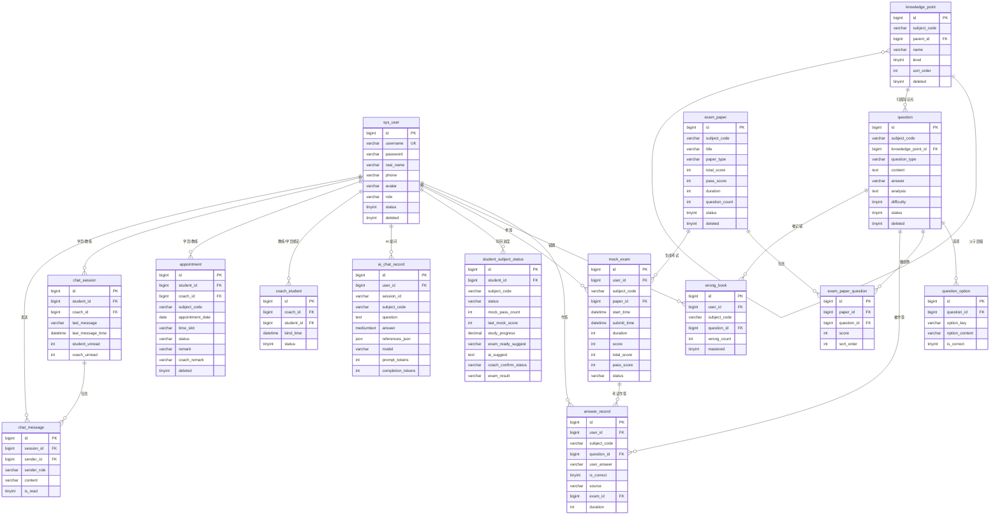

# 驾考智能辅导系统 · 数据库 ER 图

> 数据库：MySQL 8.0（库名 `driving_exam`），共 **15 张表**
> 说明：本系统**不建物理外键**。下图中所有连线均为**逻辑外键**（通过字段 + 索引维护引用关系），
> 仅为表达实体间的引用语义，数据库层不做外键约束。

## 一、表职责一览

| # | 表 | 一句话职责 |
|---|---|---|
| 1 | `sys_user` | 用户表：学员 / 教练 / 管理员统一账户 |
| 2 | `knowledge_point` | 知识点表（树形，`parent_id` 自关联） |
| 3 | `question` | 题目表（题干、正确答案、解析） |
| 4 | `question_option` | 题目选项表（A/B/C/D） |
| 5 | `answer_record` | 答题记录流水（练习与考试统一） |
| 6 | `wrong_book` | 错题本（按 用户+题目 去重） |
| 7 | `exam_paper` | 试卷表（模拟卷 / 章节卷） |
| 8 | `exam_paper_question` | 试卷-题目关联表（多对多组卷） |
| 9 | `mock_exam` | 模拟考试实例（一次考试一条记录） |
| 10 | `appointment` | 练车预约表 |
| 11 | `coach_student` | 教练-学员绑定关系表 |
| 12 | `ai_chat_record` | AI 问答记录表（RAG 预留 `references_json`） |
| 13 | `student_subject_status` | 学员科目进度 + 系统/AI/教练建议 |
| 14 | `chat_session` | 学员-教练会话表（含双方未读数） |
| 15 | `chat_message` | 聊天消息表 |

## 二、ER 图（Mermaid）

## 三、关系清单（逻辑外键）

| 主体 | 引用 | 关联字段 | 语义 |
|---|---|---|---|
| `knowledge_point` | `knowledge_point` | `parent_id` | 知识点树，自关联（0 为根） |
| `question` | `knowledge_point` | `knowledge_point_id` | 题目归属知识点 |
| `question_option` | `question` | `question_id` | 一题多选项 |
| `exam_paper_question` | `exam_paper` | `paper_id` | 试卷包含题目 |
| `exam_paper_question` | `question` | `question_id` | 题目被组卷 |
| `mock_exam` | `exam_paper` | `paper_id` | 一次考试基于某试卷 |
| `answer_record` | `sys_user` | `user_id` | 谁作答 |
| `answer_record` | `question` | `question_id` | 作答了哪题 |
| `answer_record` | `mock_exam` | `exam_id` | 考试作答时回指考试 |
| `wrong_book` | `sys_user` | `user_id` | 谁的错题本 |
| `wrong_book` | `question` | `question_id` | 错的是哪题 |
| `mock_exam` | `sys_user` | `user_id` | 谁参加考试 |
| `student_subject_status` | `sys_user` | `student_id` | 学员科目进度 |
| `ai_chat_record` | `sys_user` | `user_id` | 谁提问 |
| `coach_student` | `sys_user` | `coach_id` / `student_id` | 教练-学员绑定 |
| `appointment` | `sys_user` | `student_id` / `coach_id` | 预约双方 |
| `chat_session` | `sys_user` | `student_id` / `coach_id` | 会话双方 |
| `chat_message` | `chat_session` | `session_id` | 消息所属会话 |
| `chat_message` | `sys_user` | `sender_id` | 消息发送者 |

## 四、设计要点

1. **`subject_code` 贯穿 9 张表**：`knowledge_point`、`question`、`exam_paper`、`answer_record`、
   `wrong_book`、`mock_exam`、`appointment`、`ai_chat_record`、`student_subject_status`。
   科目一/科目四共用刷题逻辑，科目二/科目三共用预约逻辑，均通过该字段区分。
2. **逻辑外键 + 索引**：不建物理外键，全部通过字段 + 索引维护引用，避免级联约束带来的耦合。
3. **逻辑删除**：仅 5 张主数据表带 `deleted`（`sys_user`、`knowledge_point`、`question`、
   `exam_paper`、`appointment`）；流水/日志表不删除。
4. **唯一键**：`uk_username`、`uk_coach_student`、`uk_paper_question`、`uk_question_option`、
   `uk_student_subject`、`uk_user_question`、`uk_student_coach`。
5. 完整字段字典与索引定义见建表 SQL（`sql/` 目录下的导出文件）。
