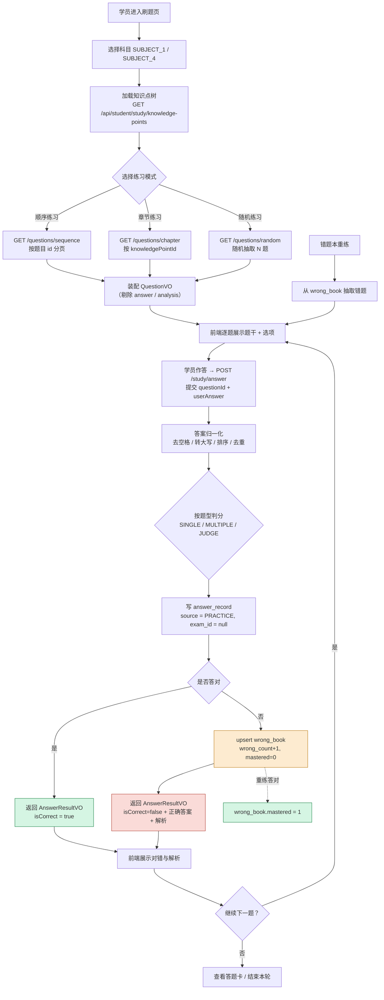

# 刷题模块 · 完整链路图

> 模块：学员端「科目一 / 科目四」刷题（顺序 / 章节 / 随机练习 + 判分 + 错题归集）
> 归档：源文件 `doc/practice-flow.md`，渲染图 `photo/design/practice-flow.png`

## 一、链路图（Mermaid）

## 二、链路要点

1. **两段式防作弊**：拉题阶段返回的 `QuestionVO` **不含** `answer` 与 `analysis`；正确答案与解析只在
   `POST /study/answer` 判分后由 `AnswerResultVO` 下发。
2. **判分是唯一的写入口**：`answer_record` 与 `wrong_book` 的写入**只发生在判分接口**，刷题接口纯查询。
3. **错题归集是 upsert**：以 `(user_id, question_id)` 为唯一键，已存在则 `wrong_count+1`、`mastered` 置 0；
   不存在则新增（`wrong_count=1`）。
4. **三种练习模式共用一条链路**：差异只在"取题目"这一步（排序/过滤/随机），从装配 VO 往后的判分、
   记录、错题归集完全复用。
5. **考试复用**：`answer_record.source` 区分 `PRACTICE` / `EXAM`，判分组件对两处通用（考试判分在后续模块接入）。
