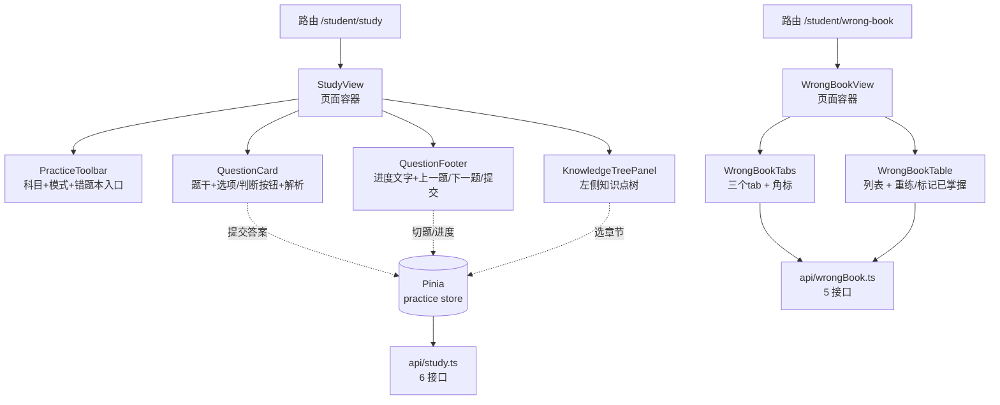

# 刷题 + 错题本 前端设计（Day 11）

> 路由：`/student/study`（刷题）、`/student/wrong-book`（错题本）
> 后端：已就绪 11 个接口（刷题 6 + 错题本 5）
> 归档：源文件 `doc/study-frontend-structure.md`，结构图 `photo/design/study-frontend.png`

---

## 一、核心设计：把"重练"做成第 4 种练习模式

刷题页**只有一套 UI**，"取题来源"和"提交接口"由模式决定：

| 模式 | 取题接口 | 提交接口 |
|---|---|---|
| `SEQUENCE` 顺序 | `GET /study/questions/sequence` | `POST /study/answer` |
| `CHAPTER` 章节 | `GET /study/questions/chapter` | `POST /study/answer` |
| `RANDOM` 随机 | `GET /study/questions/random` | `POST /study/answer` |
| **`RETRY` 重练** | `GET /wrong-book/retry` | **`POST /wrong-book/retry/answer`** |

**为什么这么设计**：错题重练本质就是"题源不同的练习"，UI 完全一致。复用同一套组件，
只需在 store 里按模式切换"调用哪个 api 方法"——**避免为重练单独写一套重复界面**。
错题本页的「重练」按钮 = 跳转 `/student/study?mode=RETRY&subjectCode=xxx`。

## 二、组件结构



> **已取消 `AnswerSheetDrawer`（答题卡）**。理由：答题卡是**考试**场景的产物（为了回头检查）；
> 刷题答完就走、错题自动进错题本，不需要回头。`QuestionFooter` 改为显示进度文字「第 X / Y 题」。
> Pinia 里的 `results` **保留**（用于渲染对错与统计），只是不再渲染答题卡 UI。

### 组件职责

| 组件 | 职责 | 关键 props / 事件 |
|---|---|---|
| `StudyView.vue` | 页面容器。读 route query（subjectCode / mode），编排子组件，**绑定键盘 ←/→ 与 touch 左右滑**，触发预加载 | — |
| `PracticeToolbar.vue` | 科目切换、模式切换（顺序/章节/随机）、**错题本入口按钮**（带当前 subjectCode 跳转） | emits: `change-subject`、`change-mode`、`open-wrong-book` |
| `KnowledgeTreePanel.vue` | `el-tree` 渲染知识点树（含 questionCount）；点击节点 → 切到章节模式 | emits: `select-node(kpId)` |
| `QuestionCard.vue` | 按 `questionType` 分支渲染；处理 `mediaUrl`；提交后展示对错 + 正确答案 + 解析 + **「AI 帮助记忆」按钮** | emits: `submit(userAnswer)`、`ai-help` |
| `QuestionFooter.vue` | 进度文字「第 X / Y 题」+ 上一题 / 下一题 / 提交 | emits: `prev`、`next`、`submit` |
| `WrongBookView.vue` | 错题本容器。**读 route query 的 subjectCode**，管理 tab、分页、列表 | — |
| `WrongBookTabs.vue` | 待攻克 / 高频错 / 已攻克 三个 tab + 角标数字（来自 summary） | v-model: `category` |
| `WrongBookTable.vue` | 列表：题干 / 题型 / 错误次数 / 最近错误时间 + 操作（重练、我掌握了） | emits: `retry`、`master` |

## 三、刷题页交互规则

| 题型 | 作答方式 |
|---|---|
| 单选 / 判断 | **点选项即判分**（无需点提交） |
| 多选 | 勾选多个 → 点「提交」→ 判分 |

| 结果 | 行为 |
|---|---|
| **答对** | 显示「✓ 正确」，**600ms 后自动滑到下一题** |
| **答错** | **停留**，显示「✗ 错误」+ 正确答案 + 解析 + **「AI 帮助记忆」按钮** |
| 未作答 | **不能翻到下一题** |

**翻页方式（四种都要支持）**：底部「上一题/下一题」按钮、键盘 `←` `→`、**触摸左右滑**。
> PC 上鼠标拖动**不**触发翻页（只认 touch 事件），演示时用键盘或按钮。

**没有"跳过"按钮** —— 跳过属于模拟考试场景，留到 Day 17。

### 「AI 帮助记忆」按钮（占位）

答错后出现。点击弹 `ElMessage('AI 帮助记忆功能开发中，将于智能问答模块上线')`。
**真实调用留到 Day 13（DeepSeek 接入）**。

## 四、分页策略：预加载

顺序 / 章节接口是分页的（`PageResult`）。

- 进页取第 1 页（`pageSize = 20`）作为本轮题目；
- **滑到倒数第 5 题时**，后台**静默**拉下一页**追加**到 `questions`（不打断作答、不显示 loading 遮罩）；
- **追加时必须去重**（按题目 `id` 比对，防止重复题）；
- 没有手动「加载更多」按钮。

> 随机 / 重练模式**不分页**（接口直接返回一个数组），无需预加载。

## 五、数据流：哪些放 Pinia，哪些放组件本地

### 放 Pinia（`store/practice.ts`）

```ts
state: {
  subjectCode: 'SUBJECT_1',
  mode: 'SEQUENCE' | 'CHAPTER' | 'RANDOM' | 'RETRY',
  knowledgePointId: number | null,
  questions: QuestionVO[],              // 本轮题目（预加载会追加）
  currentIndex: number,
  selections: Record<number, string>,   // 未提交的作答
  results: Record<number, AnswerResultVO>,  // 已判分结果
  pageNum: number,                      // 预加载用
  loading: boolean,                     // 取题中
  submitting: boolean,                  // 提交中（防重复）
  hasMore: boolean,                     // 是否还有下一页
}
getters: currentQuestion / total / progressText / isAnswered / isLast
actions: init() / loadQuestions() / preloadIfNeeded() / submit(userAnswer)
         / next() / prev() / reset()
```

> **为什么放 store**：`QuestionCard` 与 `QuestionFooter` **都要读同一份作答状态**，
> 这正是"答题卡用前端内存、不做后端接口"的延续。

### 放组件本地

| 状态 | 位置 | 理由 |
|---|---|---|
| 知识点树数据（`KPTreeNodeVO[]`） | `KnowledgeTreePanel` 本地 | 只有它用；切科目时重拉 |
| 错题本 tab、列表、分页、`summary` | `WrongBookView` 本地 | 单页面状态，无跨组件共享 |
| 按钮 loading、抽屉开关 | 各组件本地 | 纯 UI 瞬时状态 |

**不持久化**：练习会话**不写 localStorage**，刷新即重新开始。

## 六、错题本：按科目拆分

- `/student/wrong-book?subjectCode=SUBJECT_1` → 科目一错题本
- `/student/wrong-book?subjectCode=SUBJECT_4` → 科目四错题本
- **侧边菜单不展开**："科目一""科目四"保持两个顶级项；
- **错题本入口放在刷题页顶部按钮**（`PracticeToolbar` 里），点击带**当前 subjectCode** 跳转。

## 七、需要新建的文件

```
src/
├── types/index.ts                     ← 新：共享领域类型
├── api/
│   ├── study.ts                       ← 新：刷题 6 接口
│   └── wrongBook.ts                   ← 新：错题本 5 接口
├── store/
│   └── practice.ts                    ← 新：练习会话
├── views/student/
│   ├── StudyView.vue                  ← 新：刷题页
│   └── WrongBookView.vue              ← 新：错题本页
├── components/
│   ├── study/
│   │   ├── PracticeToolbar.vue        ← 新
│   │   ├── KnowledgeTreePanel.vue     ← 新
│   │   ├── QuestionCard.vue           ← 新
│   │   └── QuestionFooter.vue         ← 新
│   └── wrongbook/
│       ├── WrongBookTabs.vue          ← 新
│       └── WrongBookTable.vue         ← 新
└── router/index.ts                    ← 改：加 2 条路由
```
（**共 10 个新文件**——已去掉原计划的 `AnswerSheetDrawer`）

**还要改 `layout/StudentLayout.vue`**：
- 「科目一」→ `/student/study?subjectCode=SUBJECT_1`
- 「科目四」→ `/student/study?subjectCode=SUBJECT_4`
- **删掉**原来指向 `/student/subject1`、`/student/subject4` 的无效菜单

## 八、QuestionCard 渲染细则

| 情形 | 渲染 |
|---|---|
| `mediaUrl` 为空 | 只显示题干 + 选项 |
| `mediaUrl` 有值 | 题干上方加 `<el-image>`（图片/视频 URL） |
| 提交后 `analysis` 有值 | 显示解析 |
| 提交后 `analysis` 为空 | 显示「暂无解析」 |
| `questionType === 'JUDGE'` | 渲染**两个固定按钮**「对」「错」，**不读 `options`** |

## 九、与后端 11 个接口的对接点

| # | UI 动作 | 调用 |
|---|---|---|
| 1 | 进入刷题页 / 切科目 | `GET /study/knowledge-points?subjectCode=` |
| 2 | 模式=顺序 | `GET /study/questions/sequence?subjectCode&pageNum&pageSize` |
| 3 | 点击树节点（章节） | `GET /study/questions/chapter?knowledgePointId&pageNum&pageSize` |
| 4 | 模式=随机 | `GET /study/questions/random?subjectCode&count` |
| 5 | 模式=重练 | `GET /wrong-book/retry?subjectCode&count` |
| 6 | 提交答案（前三种模式） | `POST /study/answer` |
| 7 | 提交答案（重练） | `POST /wrong-book/retry/answer` |
| 8 | 题目详情（暂不用） | `GET /study/questions/{id}` |
| 9 | 错题本 tab 角标 | `GET /wrong-book/summary?subjectCode` |
| 10 | 错题本列表 | `GET /wrong-book?subjectCode&category&pageNum&pageSize` |
| 11 | 标记已掌握 | `PUT /wrong-book/{id}/mastered` |

## 十、必须遵守的三条契约（前端侧）

1. **判断题**：渲染两个固定按钮「对」「错」，提交 `userAnswer: '对' | '错'`（**不是 `A`/`B`**），**不读 `options`**。
2. **防作弊**：`QuestionVO` 不含 `answer`/`analysis`，**只有提交后**才从 `AnswerResultVO` 拿到。
3. **不重复弹错**：axios 拦截器已统一 `ElMessage`，页面 `catch` 只用来停 loading。

## 十一、三个实现注意点

1. **预加载防重复**：追加下一页时，按题目 `id` 比对 `questions`，已存在的不再加入。
2. **键盘事件**绑在 `StudyView` 上，但要**排除输入框聚焦时**的误触发
   （检查 `event.target` 是否为 `input`/`textarea`/`[contenteditable]`）。
3. **左右滑用 touch 事件**（`touchstart`/`touchend`），**PC 上鼠标拖动不触发**。

## 十二、实现顺序

```
11.1  types/index.ts + api/study.ts + api/wrongBook.ts
11.2  store/practice.ts
11.3  QuestionCard + QuestionFooter
11.4  PracticeToolbar + KnowledgeTreePanel
11.5  StudyView + 路由（刷题页可跑通，含预加载）
11.6  WrongBookTabs + WrongBookTable + WrongBookView
11.7  StudentLayout 菜单修正 + 联调
```
